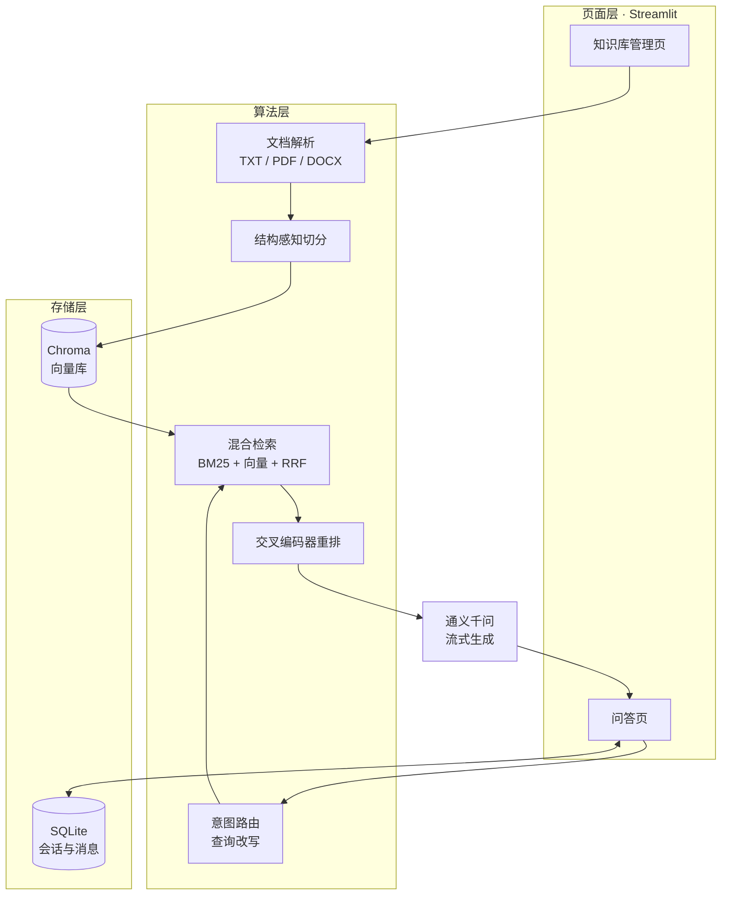

<div align="center">

# 岭南非遗文化景点智能问答系统

**本科毕业设计 · 基于检索增强生成（RAG）的领域知识问答系统**

[](https://www.python.org/)
[](https://streamlit.io/)
[](https://www.langchain.com/)
[](https://www.trychroma.com/)
[](#测试)
[](./LICENSE)

</div>

---

## 项目简介

面向岭南非物质文化遗产的领域知识问答系统。用户以自然语言提问，系统先从本地知识库检索相关史料，再由大模型基于检索结果作答，并在回答中标注引用来源。

选题针对三个具体问题：

| 问题 | 现状 | 本系统的做法 |
|---|---|---|
| 非遗资料分散 | 散落在主管部门网站、场馆展陈文本、论文中，格式异构 | 统一入库，支持 TXT / PDF / Word |
| 关键词搜索不达意 | 用户问"醒狮和舞狮有什么区别"，搜索引擎只匹配字面 | 意图识别 + 查询改写 + 语义检索 |
| 大模型会编造 | 直接问模型容易杜撰不存在的批次、传承人 | 检索约束 + 引用溯源，答案只依据命中的片段 |

## 功能特性

**知识库管理**
- 支持 TXT / PDF / Word 上传，自动识别编码与格式
- 按文档结构切分（章 / 条目），一个知识片段对应一个完整语义单元
- 内容哈希去重，重复文件自动跳过
- 按文档删除、整库重置

**问答服务**
- 意图路由：知识问答 / 自然对话 / 超出范围三类分流，跑题问题不调用知识库
- 查询改写：多轮追问中的指代与省略自动补全（"那广州呢" → 完整问题）
- 混合检索：BM25 + 向量双路召回，倒数排名融合，交叉编码器重排
- 流式输出，回答附带参考来源，可展开查看原文片段与相关度

**会话管理**
- 多会话新建、切换、重命名、删除
- 消息与会话落库，关闭浏览器后重新进入可回溯
- 回答有用性反馈，写入数据库便于后续分析

## 系统架构



系统分为**离线入库**与**在线问答**两条链路：

- 离线：上传 → 解析 → 结构化切分 → 元数据标注 → 向量化 → 写入 Chroma
- 在线：提问 → 意图路由 → 查询改写 → 双路召回 → RRF 融合 → 重排 → 提示词组装 → 流式生成 → 引用标注

## 核心设计

### 1. 为什么是结构感知切分

通用做法是固定长度切分（700 字 / 120 重叠）。在本项目的语料上实测，这种切法会让**67% 的知识片段混入两个以上不同场馆的内容**——用户问陈家祠，检索回来的片段有一半在讲隔壁永庆坊，模型很容易把两者答串。

改为按文档自身的"章 / 条目"层级切分，并为每个片段补一行 `【地区·场馆名】` 前缀，让向量同时编码"这段属于谁"。同一份语料上的对比：

| 指标 | 固定长度 | 结构感知 |
|---|---|---|
| 片段数 | 15 | 27 |
| 平均长度 | 599 字 | 295 字 |
| 混入多个条目的片段 | 10（67%） | **0** |
| 条目完整保留 | 25 / 27 | **27 / 27** |

片段数变多但总字数反而更少（去掉了重叠冗余）。识别不到结构的纯文本会自动退回递归切分，不会失效。复现脚本：`tools/compare_chunking.py`。

### 2. 为什么是混合检索

非遗领域的核心痛点是一批**低频专有名词**：香云纱、广彩、灰塑、端砚。稠密向量会把这些词和"传统手工印染""民间工艺"这类泛化语义混在一起，用户搜具体名词时召回很弱。

- **BM25** 靠字面词频匹配，正好擅长专名，但对同义改写无能为力
- **向量检索** 擅长语义相近，但会模糊掉专名

两路各召回 10 条，用 RRF（倒数排名融合，k=60）合并——只看名次不看分值，避免两种分数量纲不同无法比较（向量相似度 0~1，BM25 是开放量纲）。

### 3. 为什么加重排

融合后的前 8 条送交叉编码器重排，取前 4 条进提示词。重排模型能同时看到"问题"和"片段"，判断依据比单纯的向量距离可靠得多。实测这一步对最终答案质量影响最直接。

调用的是通义 `gte-rerank-v2`，**失败自动降级**：网络、鉴权、额度任何异常都退回融合排序，问答流程不中断。

### 4. 一个容易踩的坑：距离度量

Chroma 集合的距离度量只在创建时确定。本项目最初没有显式指定，LangChain 便按 L2 欧氏距离处理，界面上显示的"相关度"其实是 `1 - L2/√2`，**不是余弦相似度**——阈值 0.35 换算过去只相当于余弦 0.58，几乎筛不掉任何东西。

现在统一在 `vector_stores.build_chroma()` 中指定 `hnsw:space = cosine`，并在 `chroma_db/build_info.json` 里记录建库参数。改切分方式或距离度量后必须重置知识库，否则新旧片段混存。页面会自动检测并提示。

### 5. 为什么用 Streamlit 而不是前后端分离

本系统的交互重心在检索质量与答案可信度，不在界面复杂度。Streamlit 以 Python 脚本直接驱动页面，能在不投入前端工程化成本的前提下完成多页面交互，把时间留给算法与评测。

代价是单机运行、并发能力有限。这一点在设计说明书的"展望"部分有讨论，向 FastAPI + Vue 迁移的接口边界也是按此预留的。

## 目录结构

| 文件 | 职责 |
|---|---|
| `app_upload.py` | 知识库管理页：上传、列表、删除、重置 |
| `app_chat.py` | 问答页：会话管理、流式问答、引用溯源、反馈 |
| `document_loader.py` | 文档解析：TXT / PDF / Word → 纯文本 |
| `chunking.py` | 结构感知切分，含纯文本兜底 |
| `knowledge_base.py` | 入库编排：去重、切分、分批写入、原子回滚 |
| `retrieval.py` | BM25 索引、RRF 融合、重排器、混合检索器 |
| `vector_stores.py` | 向量库构建与检索入口（度量在此统一） |
| `rag.py` | 提示词组装与生成链 |
| `storage.py` | 会话与消息存储（SQLite） |
| `sqlite_history_store.py` | 对话历史（落 SQLite，读取侧裁剪窗口） |
| `config_data.py` | 模型、路径、切分与检索参数 |
| `tests/` | 单元测试（62 例） |
| `tools/` | 语料构建与切分对照实验脚本 |

## 快速开始

### 环境要求

- Python ≥ 3.11
- DashScope API Key（[阿里云百炼](https://bailian.console.aliyun.com/)申请）

### 1. 安装

```bash
git clone https://github.com/LYP961166/KnowledgeBase-RAG-LLM-System.git
cd KnowledgeBase-RAG-LLM-System
python -m venv .venv
.venv\Scripts\activate          # Windows
pip install -r requirements.txt
```

### 2. 配置 API Key

```powershell
# Windows PowerShell（当前会话有效）
$env:DASHSCOPE_API_KEY="your-api-key"
```

```bash
# Linux / macOS
export DASHSCOPE_API_KEY="your-api-key"
```

### 3. 启动

```bash
streamlit run app_upload.py     # 知识库管理，默认 8501
streamlit run app_chat.py --server.port 8502
```

### 4. 使用

1. 打开管理页 → 上传 `assets/corpus/` 下的示例文档（三种格式各一份）
2. 打开问答页 → 提问，例如"陈家祠有哪些非遗项目""香云纱是怎么染的"

## 测试

```bash
python tests/test_chunking.py
python tests/test_retrieval.py
# 或逐个运行 tests/ 下的全部文件
```

| 测试文件 | 覆盖内容 | 用例数 |
|---|---|---|
| `test_document_loader.py` | 编码识别、PDF/Word 解析、格式拦截 | 13 |
| `test_chunking.py` | 条目完整性、标题前缀、兜底切分 | 9 |
| `test_retrieval.py` | 分词、BM25 排序、RRF 去重、重排降级 | 16 |
| `test_knowledge_base.py` | 入库、去重、删除、分批限制 | 3 |
| `test_conversation_store.py` | 会话 CRUD、消息持久化、历史窗口 | 13 |
| `test_rag_conversation.py` | 意图路由 JSON 解析与校验 | 8 |

## 开发说明

### 项目沿革

本项目在开源项目 **KnowledgeBase-RAG-LLM-System**（MIT 许可，Copyright © to Rookie）的基础上，面向"岭南非遗文化景点智能问答"这一毕业设计课题做二次开发。

原始项目是一个 RAG 入门示例：单页 Streamlit、仅支持 TXT、固定长度切分、单路向量检索、历史存本地 JSON。本课题保留其整体骨架与 DashScope 接入方式，对检索链路与工程结构做了系统性改造。

### 继承的部分

- 整体技术选型：Streamlit + LangChain + Chroma + DashScope（text-embedding-v4 / qwen-plus）
- 意图路由与查询改写的提示词思路
- 分批写入向量库与失败回滚的处理方式
- 内容 MD5 去重的思路

### 重构的部分

| 模块 | 改造内容 |
|---|---|
| `app_upload.py` | 界面重做，新增多格式支持、文档卡片列表、进度反馈、提示分级与自动消失 |
| `app_chat.py` | 接入 SQLite 会话管理，新增多会话切换、引用溯源、反馈按钮 |
| `knowledge_base.py` | 切分逻辑抽离到 `chunking.py`，元数据增加文件类型与章节信息 |
| `rag.py` | 提示词上下文带章节归属，便于模型说明出处 |
| `vector_stores.py` | 统一集合创建入口，修正距离度量并加入混合检索 |
| `config_data.py` | 参数集中管理，新增检索与切分策略开关 |

### 新增的部分（本人工作）

| 模块 | 行数 | 说明 |
|---|---|---|
| `storage.py` | 266 | 会话与消息的 SQLite 存储，含引用来源、检索问题、反馈字段 |
| `retrieval.py` | 212 | 自实现 Okapi BM25、RRF 融合、重排器与混合检索器 |
| `chunking.py` | 212 | 结构感知切分，含长条目二次切分与纯文本兜底 |
| `document_loader.py` | 116 | 三种格式解析，含编码回退与扫描件识别 |
| `sqlite_history_store.py` | 55 | 将 LangChain 消息历史落到 SQLite，读取侧裁剪窗口 |
| `tests/` | 719 | 六个测试文件，62 个用例 |
| `tools/` | 730 | 语料构建器（三格式同源生成）与切分策略对照实验 |

### 与原项目的关键差异

1. **切分**：固定长度 → 按文档层级，片段混入率从 67% 降到 0
2. **检索**：单路向量 → BM25 + 向量双路召回 + RRF 融合 + 交叉编码器重排
3. **距离度量**：默认 L2（导致相似度含义失真）→ 显式 cosine，并记录建库参数
4. **会话**：本地 JSON 无列表 → SQLite 多会话管理，可回溯可删除
5. **格式**：仅 TXT → TXT / PDF / Word
6. **质量保障**：2 个测试 → 62 个测试

## 已知限制

- **知识库规模**：当前示例语料约 1.9 万字，覆盖广州、佛山及珠三角主要场馆；面向全省乃至岭南全域仍需扩充
- **扫描件**：PDF 若无文字层则无法解析，需先做 OCR
- **并发**：Streamlit 单机模型，多用户并发场景需改造后端
- **评测**：消融实验框架已就位（`tools/compare_chunking.py`），完整的 RAGAS 生成侧评测尚在进行

## 致谢

- 原始项目：[KnowledgeBase-RAG-LLM-System](https://github.com/lhh737/KnowledgeBase-RAG-LLM-System)（MIT，Copyright © Rookie）
- 开源框架：[Streamlit](https://streamlit.io/) · [LangChain](https://www.langchain.com/) · [Chroma](https://www.trychroma.com/) · [ReportLab](https://www.reportlab.com/)
- 模型服务：[阿里云百炼 / 通义千问](https://bailian.console.aliyun.com/)
- 资料参考：中国非物质文化遗产网、广东省文化和旅游厅、广州市文化广电旅游局公开资料

## License

本项目遵循 MIT 许可，原始版权归原作者所有，详见 [LICENSE](./LICENSE)。
